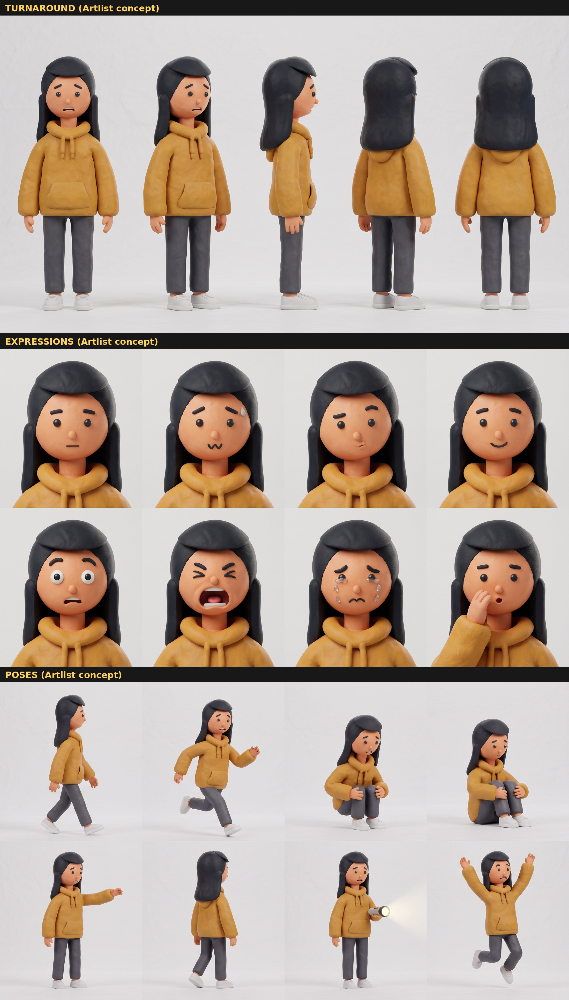

# Haru the Unfortunate: moving to clay animation in Blender (read this first)

This file hands the YouTube horror project to a new session that has **Blender on the user's PC**. It sums up everything built
and learned so far (Nov 2026) so the new session can carry on without the old chat. Read it top to bottom once, then use the
links when you need detail.

---

## 1. Start here (the new session's first steps)

1. Repo: `MohammedNainia/MohammedNainia`. Work on branch **`claude/dead-star-philosophy-reel-2kq6ee`**; commit and push there. No pull requests unless asked.
2. Read, in this order: this file, `YTB/horror/HANDOFF.md` (history and every posted reel), `YTB/horror/research/COMPETITORS.md` (what works on Shorts).
3. Check Blender on the PC: `blender --version` (Blender 4.x or 5.x). Earlier scripts were run headless as `blender -b -P script.py`
   (see `YTB/horror/paper_visitor/blender_test.py`, `build_characters.py`; MPFB2 was installed for MakeHuman bodies).
4. First job: build **clay Haru in Blender** that matches the reference board above (section 4), then a 5-second test shot (section 6).

## 2. The channel

- **Haru the Unfortunate**, YouTube channel id `UCEPxEir-yy6bpwdue24CLlA` (older notes call it PaperLit). English only. 9:16 Shorts.
- About 460 subscribers. Story reels have stopped at 1,000 to 1,500 views each; the best ever is a 58 s philosophy Short (28K).
- Recent posts: The Vacancy https://www.youtube.com/watch?v=GBh0-loW6i0 , The Pattern https://www.youtube.com/watch?v=ERJEaHH1R-I ,
  The Night Count https://www.youtube.com/watch?v=x6DN3S5Le7I , Don't Turn Around (wordless snowman) https://www.youtube.com/watch?v=FTBoaqQGOtc .
  Full list in `YTB/horror/HANDOFF.md`.

## 3. Standing rules from the user

- **Never use the long dash** in any text (scripts, captions, titles, files, messages).
- Every script is **approved by the user before building**. Publish **only after the user says publish**.
- Haru is always the lead. Pure horror, everyday situations that turn wrong. Avoid "it gets closer every time" and "wish" stories.
- Story shape: an outcome-first hook (first line), a simple rule the world follows, Haru's own choice or flaw drives it, a twist,
  a clear ending that leaves one unspoken question, and a loop (last frame cuts back to the first).
- **Length (new, from the research below): narrated reels 35 to 50 s, wordless reels 10 to 20 s.** The old rule "2:00 to 2:59" in HANDOFF.md is outdated.
- **The first second must show something wrong** (see section 9): bright, readable, the scary thing big in frame, hook text from frame 0.
- **Opening rules (Nov 26, from the Studio data in section 9, test 2):**
  - Frame 0 is bright and readable: Haru's face or the wrong thing clearly lit. Never open dark, never fade in from black.
  - **Every reel, wordless ones too, has one white hook line on screen from frame 0** that sets up the premise
    ("Every door on the street was open."). It stays about 2 s.
  - A clear sound inside the first 0.5 s (a knock, a creak, a voice), then it may go quiet.
  - Hard cap 50 s. No more 1:30 to 3:00 Shorts.
  - The last frame loops back into the first.
  - After 48 h check "Stayed to watch" in Studio: under 60% means the opening failed; the target is 65 to 70% or more.
  - No paid promotion: ad views skip the Shorts feed test and blur the numbers.
- **The clay key (Nov 26):** on every close-up and medium of Haru, add `HC.ClayRake()` and call `rake.aim(f, head, cam, src, on)`
  each frame: a small warm light that skims across her face from the side of a real source (lamp, candle, window, phone),
  0.22 W at 6 cm. Soft head-on light makes her clay look like a smooth ball; raking light shows the dents, thumbprints and
  hair grooves. Wide and "something is wrong" shots stay dark. 0.5 W is too much (greys her hair, washes the hoodie).
- Captions white, short sentence-safe chunks; other speakers in pink italic. Loudness -14 LUFS (two-pass loudnorm).
- Renders happen on the user's PC (RTX 5090). Final mp4s are not committed (`*.mp4` is gitignored); raw renders are pushed with `git add -f`.

## 4. Haru: the character bible

**The look comes from the Artlist concept sheets** (made with Nano Banana in Artlist, clay/plasticine style):
- `YTB/channel_art/haru_turnaround_sheet.png` (front, 3/4, side, back), `haru_expressions_sheet.png` (8 faces), `haru_poses_sheet.png` (8 poses),
  `haru_ref.png` (a lit close-up), `haru_blank_face2d.png`. All on the board above.
- Artlist generation id of **Haru with a blank face** (used to make every other library character in the same style): `01a20472-a03b-705e-beec-2791c8c5c082`.

**Design:**
- A girl about 1.26 m tall, child proportions with a big head (about 1/4.5 of her height).
- **Mustard / ochre hoodie**: kangaroo pocket, two drawstrings, soft thick folds, cuffs over the wrists.
- Charcoal grey trousers, straight. White sneakers with grey soles.
- **Long straight black hair** past the shoulders, a side-swept fringe, one solid clay mass with soft grooves.
- Warm tan skin (`#e2a07e` was our face target colour).
- Simple face: small dark dot eyes with a tiny white catchlight, thin dark brows, a small round nose, a small simple mouth. No lashes, no blush.
- Matte plasticine everywhere: soft fingerprints and tool marks, rounded edges, slightly uneven surfaces, never glossy.

**Expressions we use** (from the sheet and our code): neutral, worried, scared (small "o" mouth), terrified (wide eyes, scream),
sad / crying, smile, relieved, sleepy, suspicious, surprised, shock. Story faces: **closed eyes**, **wide eyes** (whites showing),
and the "thing wearing her face": **huge white eyes with pinprick pupils and an ear-to-ear grin full of teeth** (Mirror Rules, Vacancy).

**Poses we use**: relaxed stand (weight on one leg), walk, run, crouch, sit on the floor hugging knees, sit on a chair,
sit up in bed, lie in bed, point, look back over the shoulder, hold a torch, arms up / jump, hand over mouth.

**Other characters** (all made in the same Artlist clay style, as GLB models with textures in `YTB/horror/three/data/lib/chars/`):
`mum` (plum sweater, low bun), `dad` (light blue shirt), `grandma` (white bun, lilac cardigan, grey skirt), `woman_red` (long black hair,
red coat; recoloured as a nurse), `boy` (green hoodie), `girl` (pigtails, pink sweater), `man_tired` (beige raincoat). Heights are in
`data/lib/index.json`. Haru's GLB is `chars/haru.glb` (its face was flattened with `YTB/horror/tools/glb_face_flatten.py`).

## 5. What we built in three.js (and what carries over to Blender)

Everything so far was rendered in the browser with three.js: `YTB/horror/three/` (`render.js` renders a scene to video;
`scenes/*.html` are the reels; `scenes/clay.js` is the clay look; `scenes/glb_person.js` rigs the library models).
The library (`data/lib`) has 8 characters and 43 props (hospital bed, chair, motel, church, cemetery, playground, car, fence,
house, ...), all GLB, all reusable in Blender (File > Import > glTF; props are at real size in metres when scaled to the height or
length in `index.json`).

**Lessons that apply in Blender too:**
1. **Clay look**: matte (roughness about 0.85 to 0.9), a soft sheen, a fine noise bump for fingerprints, a faint rim light.
   **Stop motion**: 12 poses per second (animate on twos), and a small "boil" (the surface shifts slightly every new pose).
   Shallow depth of field (miniature look). One colour grade per place (warm lamp, cold night, dread).
2. **Faces**: the generated models' sculpted faces looked lumpy; we drew the face in 2D on a smooth face plate instead
   (eyes, brows, mouth changed per frame). In Blender the same idea works as **swappable face decals** (image textures per expression,
   like stop-motion replacement faces) or as shape keys on a clean sculpted head. Keep the faces simple, as on the sheet.
3. **Contact** (the user insisted this never happens again): characters must sit ON chairs and lie ON beds, never sink in.
   We measured each prop's real shape and placed bodies on it (`scenes/contact.js`), and checked every frame before rendering
   (`three/check_contact.js`). In Blender: snap to the surface with ray casts from the mesh, use collision for cloth,
   and check intersections before rendering.
4. **Bed covers** drape over the body's real shape (never a box). In Blender use cloth simulation or a shrinkwrapped, smoothed sheet.
5. **Skirts** must follow the thighs when a character sits (otherwise the hem hangs through the seat and lifts her off it).
6. **Beds** lie lengthwise with the pillow at the head end; hospital beds were too tall (we scaled them to 78%).
7. **Shadow acne** (rings on faces under a low light) was fixed with a shadow bias; in Eevee watch the same artefact.
8. **Cameras**: aim close-ups from where the face actually points; never let hair or props block the subject; check occlusion on every shot.
9. **Mirrors**: a negative-scale (mirrored) copy hid the drawn face, and a transparent glass that writes depth hid what was behind it.
   In Blender just use a real mirror material (Cycles, or Eevee with screen-space or planar reflections) and a second puppet only when the
   reflection must disobey.

## 6. Suggested Blender setup (to confirm with the user)

- **Two ways to drive Blender:** headless scripts the PC's agent runs (`blender -b -P build.py -- args`, as in `paper_visitor/`),
  or the Blender MCP add-on (Claude drives an open Blender live). Scripts are easier to version and re-run.
- **Render**: Cycles on the RTX 5090 (OptiX, denoiser) for the best clay; Eevee for fast drafts. 1080x1920, 24 fps timeline with poses on twos
  (or 12 fps output), filmic / AgX view, a little film grain.
- **Clay material**: Principled BSDF, roughness 0.85, a touch of subsurface (warm), a noise or Voronoi texture into a bump node
  for fingerprints, and a boil: offset the noise texture's coordinates on every new pose.
- **Rig**: Rigify on a clean clay body, or the existing joint positions in `chars/haru.rig.json` (hip, knee, ankle, shoulder, elbow, wrist,
  neck, head top) to place bones on `haru.glb`. Hair as its own mesh with a bone for a little swing.
- **First test**: a 5-second shot of Haru standing in a lit room, blinking, then turning to look over her shoulder; compare it side by side with the board.

## 7. Voices and sound (unchanged by Blender)

- Narrator: Haru = **Samara X** (Artlist voice id 224933), Eleven v3, stability 0.5, one generation per line. Artlist had **49 credits left**,
  renewing 2026-11-28 (3D models cost 300 credits, so new GLB assets wait for credits). Other voices: Assistance (id 44), Zara Soft (224951), Grounded (85), Shadow (24).
- **Local VoiceStudio** on the user's PC (OmniVoice, API `127.0.0.1:3900`) clones Samara from `YTB/horror/pattern/voice/h02.mp3`
  (ref text: "Inside, the guide made us walk his way. Five slow steps. Two fast. Over and over."). The brief format the PC agent follows:
  `YTB/horror/mirror_rules/voice/VOICESTUDIO.md`.
- Pipeline: lines sped to 1.5x with atempo, word timings with faster-whisper (`YTB/horror/tools/trw.py`), `voice/build_layout.py`
  (lays lines on the timeline -> `layout.json`, `words.json`), lip sync with Rhubarb (`YTB/horror/tools/mouths.py`).
- Each reel's `post.py` takes the silent render and adds captions, voice, synthesized sound design and loudness. It does not care which
  renderer made the video, so it works unchanged for Blender renders (name the file `raw.mp4` in the reel's folder).

## 8. Publishing

- vidIQ (MCP): `vidiq_video_upload` with `localFile` (then run the returned shell command, then call again with the uploadId) ->
  `vidiq_social_post_draft_create` (YouTube `UCEPxEir-yy6bpwdue24CLlA`, public, category 24, tags) -> show the user ->
  `vidiq_social_post_publish` only after "publish" -> `vidiq_social_post_status` for the URL. Upload and publish cost nothing;
  vidIQ research tools need credits (the balance ran out on Nov 24).
- Reels that use a **trending sound** go up from the user's phone (YouTube app, Add sound), so the sound is licensed and the Short
  shows on the sound's page. Never bake a copyrighted sound into our file.

## 9. What the research says (Nov 24) and the live tests

From `YTB/horror/research/COMPETITORS.md` (thelovelyhorrorshow 10M, LIGHTS ARE OFF 5.6M, ParaHaunt 465K in 6 months, Mr.spinechill, dsand...):
- The biggest horror Shorts are **wordless, 4 to 25 s**: one creepy image that loops. Narrated hits run **27 to 60 s**. Ours averaged 84 s.
- **The scary thing is shown big in the first second**, bright and high contrast. A familiar thing made wrong (Santa, a snowman, a dog).
- A fixed look on every video (brand frame), numbered series with one recurring character, rule hooks in the second person
  ("Don't X at midnight"), known legends people search for.
- **Nobody big makes clay horror Shorts**: that is our gap, and Blender clay is how to own it.

**Test 1, Don't Turn Around (wordless, 12 s)**: 1,000 views in 84 minutes (460 above our usual), but only **25.9% stayed to watch**
(74.1% swiped away), so YouTube stopped pushing it. Cause: the first frame was a calm grey wide shot; the scary part came at 4 s.
Lesson: **something wrong on screen in the first second.**

**Test 2, the whole channel (Studio, lifetime, Nov 26)**: almost every Short stops at 0.9k to 1.5k views. Channel stayed to watch
is 51.4%; per Short it runs 28% to 64%, and none reached about 70%, so none passed the first feed test. The one "28k" Short
(Perfect Life) got 26.9k of those views from YouTube ads (20.2k skippable, 6.7k Shorts ads); organically it also stopped near 1.3k.
The wordless reels were looped more than once by those who stayed (102% to 142% viewed) but lost the most at the swipe
(Don't Turn Around 28.6%, Something Came In 36.7%, Lights Off 38.2%). The best openings stated the premise at once
(Baby Monitor Singing 64.2%, Mum Calls 63.8%, Three Kids 63.2%). Lesson: **the content holds, the first frame does not; say the premise
on screen at frame 0, even in wordless reels.**

## 10. In progress when this session ended

- **Mirror Rules** (narrated, about 25 to 30 s, three.js): script approved (`YTB/horror/mirror_rules/script.txt`), scene built
  (`three/scenes/mirror_rules.html`), `post.py` ready. Waiting for Haru's VoiceStudio lines from the PC agent. Planned fix before rendering:
  the reflection blinks at 0.4 s (not 1.1), a tighter first frame, hook text from frame 0. The user may want it remade in Blender clay instead.
- **Trending-sound reels**: the user picks funny trending sounds in the YouTube app; we build a horror reel timed to the sound's beat,
  render it silent, and the user uploads from the phone with that sound.
- Snowman re-cut idea: open on the snowman's grin over her shoulder (post later as a separate test).

## 11. Environment notes (the cloud container)

- No Blender, no GPU here; installing `bpy` and `yt-dlp` was refused by the session's permission check. Blender work runs on the PC.
- The YouTube Data API works through the proxy with no key parameter (`https://www.googleapis.com/youtube/v3/...`).
  `i.ytimg.com` (thumbnails) was added to the environment's allowed hosts on Nov 24.
- Useful skills in `.claude/skills`: clay-character, camera-cinematography (Blender camera work), writing-principles, storyteller, cinematic-director.
